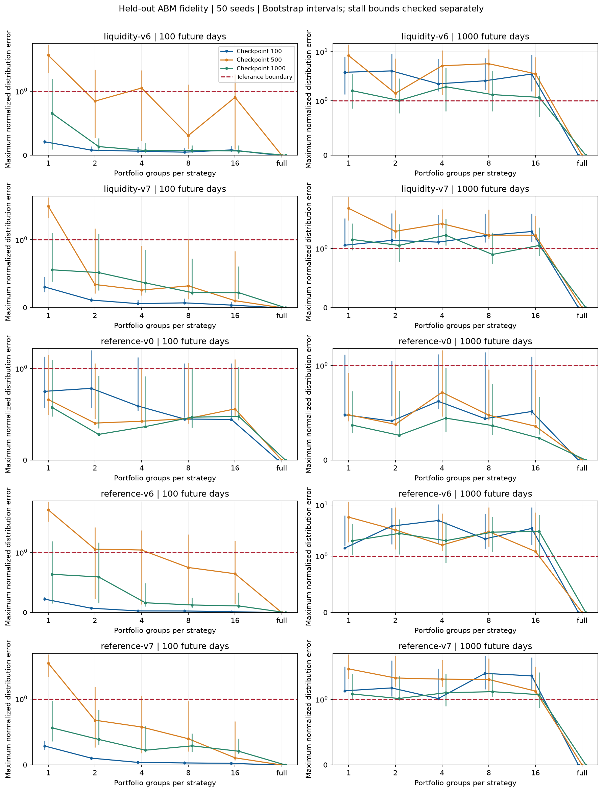
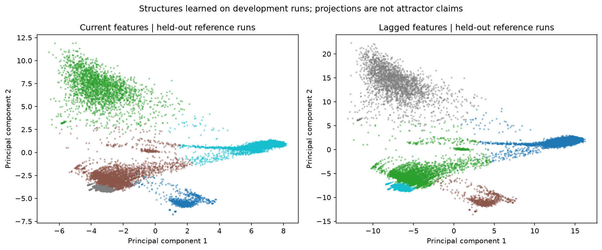
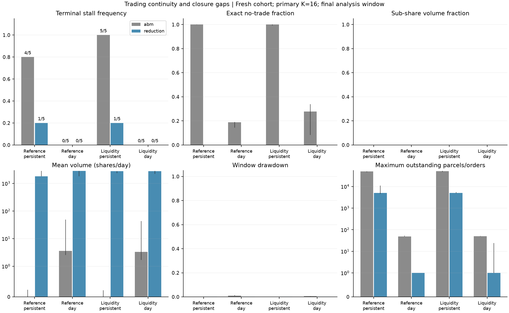
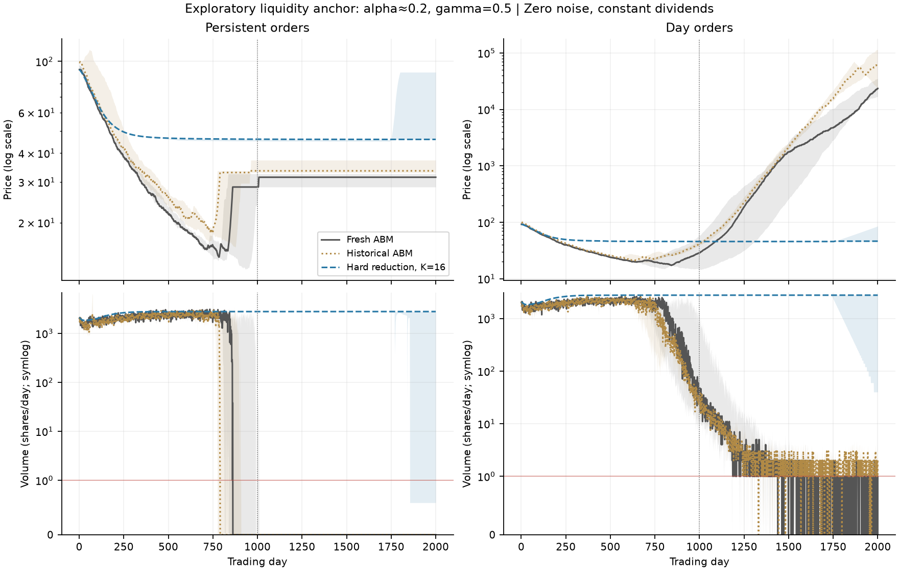
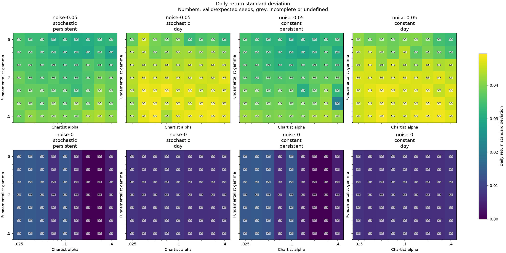
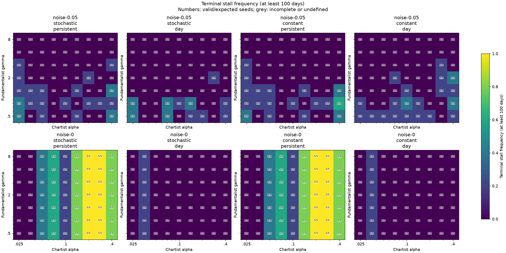

# Engineering improvements: validation record

## Retained individuality and structure discovery: task 5 (2026-10-30)

Implemented on `feat/research-heterogeneity-study`, branched from integration
commit `abc1324` after the approved scope revision. Simulation execution source
is `6db78d5`. The ordinary market loop is shared with the checkpoint interface;
the existing simulation APIs, model rules, random-draw order, and schema-1 bundle
layout are preserved. Existing untracked research files remain untouched.

Validated task head `fcd40a6` merged on 2026-10-30 through
[PR #8](https://github.com/Roman223/Agent_modelling/pull/8) as `287bd13` into
`research/emergent-dynamics`. The merged tree was verified identical to that
validated head before this documentation update. Integration PR #3 remains draft
for final combined user validation.

The experiment compresses individual portfolios once, after a specified number
of completed trading days, and then resumes the original individual trading.
It retains every trader, original order ownership and queue priority, price
memory, and RNG state. This tests sensitivity to initial portfolio information;
it does not supply a permanently compressed simulator or a speedup. No governing
market equations or deterministic chaos claim are introduced.

SciPy's Ward linkage and nested cuts supply the grouping. Its minimum-cost
assignment supplies exact empirical joint Wasserstein-1 distances for equal
uniform portfolio samples, avoiding a separate transport LP solver. Scaling,
PCA, K-means, silhouette scores, and adjusted Rand scores reuse scikit-learn.
HARK was assessed as a distribution-representation precedent; replacing the
existing market engine would not preserve its trading and queue semantics.
SciPy is now a direct dependency; the existing pinned version is unchanged.
References: [SciPy Ward linkage](https://docs.scipy.org/doc/scipy/reference/generated/scipy.cluster.hierarchy.ward.html),
[minimum-cost assignment](https://docs.scipy.org/doc/scipy/reference/generated/scipy.optimize.linear_sum_assignment.html),
[scikit-learn clustering](https://scikit-learn.org/stable/modules/clustering.html),
and [HARK architecture](https://docs.econ-ark.org/docs/overview/ARKitecture.html).

### Validation

| Command | Result |
| --- | --- |
| `.venv/bin/python tests/test_heterogeneity.py` | 13/13 passed |
| `.venv/bin/python tests/test_core.py` | 19/19 passed |
| `.venv/bin/python tests/test_logging.py` | 11/11 passed |
| `.venv/bin/python tests/test_bundles.py` | 9/9 passed |
| `.venv/bin/python tests/test_experiments.py` | 18/18 passed |
| `.venv/bin/python tests/test_atlas.py` | 10/10 passed |
| `.venv/bin/python tests/test_reduction.py` | 16/16 passed |
| `.venv/bin/python tests/test_legacy_equivalence.py` | 25/25 identical to notebook `84fa2a6` |
| Python compilation, `pip check`, and `git diff --check` | Passed |

All 96 focused checks passed. New checks cover checkpoint round trips and exact
continuations under all eight forcing/order-lifetime controls; immutable inputs
and caller RNG restoration; nested grouping; cash and integer-share conservation;
empty and identical portfolios; unchanged order ownership; and exact full detail.
Known-answer outcome fixtures exercise passing, failing, inconclusive, and
nonmonotone threshold decisions. A stall at a short horizon cannot borrow
no-trade days from before the checkpoint.

The CLI workflow test interrupts and resumes a small study, reuses published
artifacts, rejects corrupted outputs and changed provenance, explicitly retries
damaged reference and continuation artifacts, and renders/reuses a report. A
retried reference reproduces its original bytes and dependent artifact identity.
The test also checks that discovery training and validation seeds are disjoint.
A live SIGTERM test confirms that an active worker exits, its attempt is marked
interrupted, and a resumed study completes. The rendering fixture includes a
primary 100-day fidelity comparison, all eight supported detail levels, and
deduplication of capped full-detail states. The interruption test observes launch
logs, avoiding read-lock contention with the ledger writer during startup.
Final test logs are `/tmp/task5-heterogeneity-tests.log`, `/tmp/task5-focused.log`,
and `/tmp/task5-legacy.log`.

Checkpointing initially exposed a Python 3.12 compatibility issue: converting
NumPy scalar order prices to Python floats changes summation rounding. Tagged
scalar serialization preserves transition-relevant types. Historical wealth
values remain ordinary floats because they do not affect future decisions.
The exact-continuation and legacy checks passed after that correction.

### Pilot protocol

Study: `results/task5_heterogeneity_20261030`. Five stored atlas configurations
are used: reference coordinate `(4, 3)` variants 0/6/7, and liquidity coordinate
`(6, 0)` variants 6/7. Stored floating-point parameter values are retained exactly.
Variant 0 uses original forcing and persistent orders; variant 6 uses zero closing
noise, constant dividends, and persistent orders; variant 7 adds day expiry.

Development seeds are 300–309; independent validation seeds are 310–359. Each of
300 references runs for 2,000 days. Checkpoints after 100, 500, and 1,000 days
yield 900 jobs, each continuing for 1,000 days at 1/2/4/8/16/full portfolio groups
per strategy. Identical snapshots are deduplicated within a job. Every full-detail
continuation must match reference daily arrays and the final state/RNG digest
before its artifact is published.

Primary comparisons use horizons 100 and 1,000; horizons 1 and 20 are descriptive.
Tolerances, transforms, seed-bootstrap settings, and lagged/current discovery
settings were frozen in the study manifest before simulation. The
[README](README.md#portfolio-detail-and-structure-discovery-task-5) defines
them. Intervals are exploratory per comparison, not a simultaneous certification
of a universal threshold. Independent ABM seed halves report sampling variability
without changing the equivalence tolerances.

Task 4's [historical hard-reduction comparison](#hard-rule-deterministic-reduction-task-4-2026-10-27)
remains a separate baseline. Its one deterministic pool per strategy discards
individual trading and changes matching; it is not Task 5's one-group endpoint.
The older cohorts and interventions must not be treated as paired Task 5 runs.

All 300 reference runs completed. The table describes the independent validation
cohort, seeds 310–359, over reference days 1,001–2,000. Stalls mean 100 terminal
exact no-trade days. Volume and no-trade entries are medians of per-run summaries.

| Full-ABM setting | Terminal stalls | Mean daily volume | No-trade days |
| --- | ---: | ---: | ---: |
| Reference, original forcing, persistent orders | 1/50 | 3,372.438 | 0.0% |
| Reference, zero closing noise, constant dividends, persistent orders | 18/50 | 170.7155 | 10.75% |
| Reference, zero closing noise, constant dividends, day orders | 2/50 | 2.7175 | 13.4% |
| Liquidity, zero closing noise, constant dividends, persistent orders | 32/50 | 0.739 | 97.8% |
| Liquidity, zero closing noise, constant dividends, day orders | 3/50 | 3.113 | 12.2% |

The liquidity stall contrast appears in this larger cohort, but neither persistent
orders nor day expiry determine a single outcome for every seed. These full-ABM
figures establish the new comparison baseline; they do not measure compression
fidelity or agreement with actual markets.

### Completed execution and report audit

- All 300 references, 900 checkpoint jobs, and 5,400 unique continuations completed.
  Every full-detail continuation matched its uninterrupted reference exactly.
- The study started with two workers and switched to four after the user approved
  the measured memory use. Two in-flight reference attempts were interrupted by
  that switch and recovered on resume. There were no failed or missing jobs;
  every continuation job completed on its first attempt.
- References took 12m 21.84s including the worker-count change; continuations took
  71m 31.30s. Each phase benchmarked serially before expanding. Peak completed-worker
  RSS was 225.5 MiB for references and 239.9 MiB for continuations.
- All batches stayed below 120 minutes, with one native numerical thread per
  worker, a 6 GiB study memory limit, 5 GiB output cap, and 10 GiB free-disk floor.
  The audited study occupies 0.837 GiB; 30.92 GiB remained free.
- Reporting took 41.30 seconds and peaked at 949.0 MiB RSS under a 4 GiB
  address-space cap. All four PNG/PDF figures were visually inspected.

Final report identity:
`d825cb3e7c155feafe2e0ee50d2169658a0d81ebbe2b160992b8c23112e1e522`.
It contains 21,600 per-run/horizon records, fidelity comparisons, candidate
thresholds, independent ABM sampling baselines, frozen numerical transforms,
and four figures in PNG/PDF. All 11 report payload hashes, all 1,200 input artifact
hashes/identities, and all 26 execution-source hashes against commit `6db78d5`
were verified. The audit receipt is `results/task5_heterogeneity_20261030/audit.json`.

The final renderer adds colors for the eight levels/checkpoints accepted by the
CLI and displays the validation seed count. These plotting-only changes have
independent rendering provenance. Resume historical execution at `6db78d5`;
the current renderer reads the completed study without changing its simulation
identity. The final 13-check Task 5 suite passed again after the rendering and
interruption-observer adjustments.

### Fidelity findings

There is no supported universal individuality cutoff in this pilot. Of the 150
held-out compressed-level comparisons, 47 were within tolerance, 50 outside,
and 53 inconclusive. Full detail was exact in all 30 condition comparisons.
Requiring a level and every finer tested level to pass leaves 11 candidate
thresholds across 30 configuration/checkpoint/horizon combinations.

Entries below give the smallest supported number of groups per strategy at
checkpoints 100 / 500 / 1,000, respectively. A dash means no supported compressed
threshold: at least one finer tested level was outside tolerance or inconclusive.
It does not mean every compressed level was proven inadequate.

| Configuration | Next 100 days | Next 1,000 days |
| --- | --- | --- |
| Reference, original forcing, persistent (`v0`) | — / — / — | — / — / 1 |
| Reference, zero closing noise, constant dividends, persistent (`v6`) | 1 / — / 4 | — / — / — |
| Reference, zero closing noise, constant dividends, day orders (`v7`) | 1 / 8 / 1 | — / — / — |
| Liquidity, zero closing noise, constant dividends, persistent (`v6`) | 1 / — / 2 | — / — / — |
| Liquidity, zero closing noise, constant dividends, day orders (`v7`) | 1 / 16 / 4 | — / — / — |

For the original-forcing reference, one group per strategy at checkpoint 1,000
is a candidate over the following 1,000 days: the maximum normalized empirical
distance is 0.370, with bootstrap interval [0.286, 0.731], and the paired stall
difference interval is [-0.0839, 0.0839]. Every finer tested level also passes.
The other five original-forcing conditions lack a supported threshold; their
compressed comparisons are mostly inconclusive, with none classified outside
tolerance. This distinction matters when separating lack of evidence from a
demonstrated fidelity gap.

Across the four controlled configurations, no compressed level passes the
1,000-day criteria: 46 of those 60 comparisons are outside tolerance and 14
inconclusive. Shorter-horizon candidates therefore do not establish long-horizon
fidelity. Neither increasing detail nor changing the horizon gives a uniformly
monotone result.

Pooled median retained portfolio dispersion is approximately 68%, 92%, 98%, and
99.9% for 2/4/8/16 groups; it is near zero for one group. These summaries pool
strategies, configurations, and checkpoints. Of 2,250 held-out strategy/checkpoint
cases, 609 have zero original dispersion and remain explicitly undefined in the
retention ratio. High retained variance alone does not guarantee the tested
market outcomes. The per-case joint portfolio errors and availability changes
remain in the numeric records.

These are one-off initial-information interventions. All 100 traders, their
individual decisions, and their order ownership remain; trading can recreate
portfolio differences. The results do not validate a permanent one-pool model,
a reduced agent count, a runtime speedup, or agreement with actual market data.
Task 4's separate closure failures remain unchanged.

### Discovered structure and the lag comparison

The representation uses 9,800 development rows and 49,000 held-out rows from
independent seed cohorts. Current features have 66 coordinates; the lagged
version has 264. Both select five clusters using development silhouette scores
in an eight-component PCA representation.

| Representation | Development variance retained by 8 PCs | Held-out reconstruction MSE | Five seed-bootstrap cluster ARIs |
| --- | ---: | ---: | --- |
| Current | 83.52% | 0.1711 | 0.9885–0.9988 |
| Current plus lags 1/5/20 | 81.44% | 0.1930 | 0.9863–0.9982 |

Reconstruction losses refer to different feature spaces and are not a direct
forecast comparison. Cluster stability refits K-means with frozen scaling/PCA;
it does not quantify uncertainty in the entire representation fit. The clusters
separate distinct activity/return patterns, including a group whose median and
interquartile future outcomes are zero return, zero volume, and all no-trade days.
Cluster identifiers and colors are arbitrary within each representation.

The shared next-20-day targets give a direct descriptive prediction comparison.
The baseline is the development cohort's global mean; cluster predictions use
development cluster means, evaluated on the held-out runs.

| Future target | Global-mean MAE | Current-feature MAE | Lagged-feature MAE |
| --- | ---: | ---: | ---: |
| Cumulative log return | 0.10840 | 0.05963 | 0.06076 |
| Mean daily log(1 + volume) | 3.00730 | 0.91636 | 0.90643 |
| No-trade fraction | 0.24424 | 0.06253 | 0.06246 |

Both representations improve on the global-mean baseline for all three targets;
their seed-bootstrap MAE-difference intervals are entirely below zero. Additional
lags give a small volume improvement, slightly worse return prediction, and
almost unchanged inactivity prediction. This comparison does not show a
consistent advantage for the lagged representation. It does not rule out other
temporal models: current features already include price-memory signals, and
cluster-mean prediction is a limited forecasting method.

The frozen transforms were also applied to every held-out compressed continuation.
The report records their reconstruction errors, cluster occupancies, and future
prediction errors without refitting on intervention data. This establishes
reproducible descriptive and predictive structure for the selected ABM cases,
not an autonomous low-dimensional dynamics model or a chaos result.

### Task 6 handoff

Keep deterministic continuation and bifurcation analysis deferred: no autonomous
deterministic transition map has been validated. The next useful specification
would test state sufficiency and learned forecasts against stronger persistence
and configuration-specific baselines, including generalization within each
market configuration. Any permanent compression or reduced-agent simulation
needs a new validation design; the present one-off intervention cannot establish
it. Specify that follow-up before implementation. Task 7's
multifractal scope is unchanged, and integration PR #3 remains draft for the
combined user validation.





## Hard-rule deterministic reduction: task 4 (2026-10-27)

Implemented on `feat/research-hard-reduction`, branched from integration commit
`60b765d` after task 3. Simulation execution source is `a1e3f3d`. Subsequent
plotting-only changes use logarithmic price axes and nonnegative activity axes;
they are separately fingerprinted in the final report. The original simulation,
trader, asset, matching, scenario, metric, bundle, and experiment-runner sources
were not edited. Existing untracked research files were left untouched.

Validated task head `dab21ed` merged on 2026-10-28 through
[PR #7](https://github.com/Roman223/Agent_modelling/pull/7) as `d3f3a60` into
`research/emergent-dynamics`. The merged tree was verified identical to the
validated task head before this documentation update. Integration PR #3 remains
draft for the final combined review after tasks 1–7.

The implementation adds a pure deterministic day-order map and a persistent
queue companion, preserving strategy cash/shares and accepted-price memory.
Noise participation is integrated by branch; conditional quote distributions
use 16-point Gauss–Legendre quadrature, checked at 8 and 32 points. Hard decisions
are evaluated before weighting. Portfolio pooling, fractional flows, and
matching the weighted order measure are explicit closure assumptions, not an
exact expected ABM transition. Equations, APIs, limitations, and reproduction
commands are in the [README](README.md#hard-rule-deterministic-reduction-task-4).

Mesa and PyDSTool were assessed; the model-specific closure is implemented with
the existing NumPy stack, while existing process limits, artifact utilities,
and the ABM runner are reused. No dependency was added. References:
[Mesa activation](https://mesa.readthedocs.io/latest/tutorials/2_agent_activation.html),
[PyDSTool hybrid systems](https://pydstool.github.io/PyDSTool/HybridSystems.html), and
[NumPy quadrature](https://numpy.org/doc/stable/reference/generated/numpy.polynomial.legendre.leggauss.html).

### Validation

| Command | Result |
| --- | --- |
| `.venv/bin/python tests/test_reduction.py` | 16/16 passed |
| `.venv/bin/python tests/test_core.py` | 19/19 passed |
| `.venv/bin/python tests/test_logging.py` | 11/11 passed |
| `.venv/bin/python tests/test_bundles.py` | 9/9 passed |
| `.venv/bin/python tests/test_experiments.py` | 18/18 passed |
| `.venv/bin/python tests/test_atlas.py` | 10/10 passed |
| `.venv/bin/python tests/test_legacy_equivalence.py` | 25/25 identical to notebook `84fa2a6` |
| `.venv/bin/python tests/test_reduction.py StudyTests.test_cli_interrupt_resume_and_published_reuse` | Passed again after the plotting-axis adjustment |

All 83 focused checks passed. Rule comparisons cover prescribed random draws,
resource boundaries, minimum quantities, the chartist sell fallback, and
fundamentalist allocation. Other checks cover price/time priority, partial
fills, conservation, within-strategy execution, pre-expiry diagnostics, exact
zero versus fractional volume, unchanged-price memory updates, no-trade memory
freezing, deterministic repetition, RNG preservation, and immutable inputs.
The workflow test verifies time-limit interruption/resume, serial versus worker
results, reuse of published artifacts, recovery of interrupted staging,
corruption rejection and explicit retry, provenance rejection, and rendering.

Tests ran in managed background sessions with logs under
`results/task4_development/` and one native numerical thread per process. The
default legacy suite completed in 106.8 seconds. The six figures were visually
inspected; final report payloads and the selected committed PNG copies were
checksum-verified. Price plots use log axes so that order-of-magnitude gaps are
visible. Activity plots retain zero and do not show negative volume ranges.

### Pilot execution

Study: `results/task4_reduction_20261027`. Stored Task 3 grid coordinates select
the reference `(4, 3)` with all eight variants, plus `(6, 0)` variants 6/7 for
the liquidity contrast. The latter retains alpha `0.19999999999999998` rather
than substituting a rounded parameter. Each run spans 2,000 trading days; metrics
use the final 1,000, while path figures include the preceding trajectory.

- Reused 50 validated historical ABMs, seeds 100–104.
- Completed 50 fresh ABMs, seeds 110–114, in 66.25 seconds.
- Completed 120 reductions: four parameter/lifetime configurations, ten recorded
  initial histories, and three quadrature resolutions, in 116.01 seconds.
- Both phases used a serial benchmark before expanding to two workers. The ABM
  benchmark took 3.35 seconds; the persistent reduction benchmark took 1.74 seconds.
  Maximum worker RSS was 86.8 MiB for ABMs and 82.6 MiB for reductions.
- All 170 new runs completed on their first attempt, with no failed or missing
  runs. Configured limits were 6 GiB combined memory, 5 GiB output, 10 GiB minimum
  free disk, and a 120-minute batch. The study uses 54.43 MiB including the first
  and final rendering; free disk remained about 36 GiB.

Final report identity:
`5956ebce49d071eb5bc224f590911a12ff1ccdecb4bc1c63c06b2e690e0ce29e`.
It contains 220 per-run records, cohort-separated summaries and numeric tables,
and six figures in PNG/PDF. All 15 report payload hashes were verified. Two
representative PNGs, 470,618 bytes combined, are retained in Git; raw study data
remain gitignored. The source and completion hashes of every comparison input
are recorded. Resume historical execution at `a1e3f3d`; the current renderer
accepts those completed artifacts without changing their execution identity.

### Findings and task 5 handoff

The pooled closure fails the intended ABM fidelity comparison. This is a
scientific limitation of the tested approximation, not an execution failure.
The table uses fresh seeds 110–114 and the primary 16-point reduction. Each
reduction count refers to five initial histories, not five stochastic trajectories.
Stalls mean at least 100 terminal exact no-trade days; volume entries are medians
of per-run mean daily volume in the retained window.

| Coordinate / orders | ABM stalls | Reduction stalls | ABM volume | Reduction volume |
| --- | ---: | ---: | ---: | ---: |
| Reference / persistent | 4/5 | 1/5 | 0 | 1,787.75 |
| Reference / day | 0/5 | 0/5 | 3.582 | 2,799.77 |
| Liquidity / persistent | 5/5 | 1/5 | 0 | 2,779.79 |
| Liquidity / day | 0/5 | 0/5 | 3.304 | 2,779.80 |

The fresh ABMs reproduce the selected liquidity stall contrast, but the reduction
substantially underrepresents persistent-order stalls and day-order intermittency.
Median no-trade fractions for fresh day-order ABMs are 18.9% at the reference and
27.7% at the liquidity anchor, versus zero in both reductions. In each primary
reduction cell, the median within-strategy fraction of positive executed volume
is approximately 100%. Thus continued volume can be internal circulation in a
pooled strategy without comparable inter-strategy resource exchange. This does
not establish the same decomposition for the ABM, whose compact summaries lack
counterparty-level information.

Price behavior also differs materially. Fresh day-order median final prices are
105,953.86 at the reference and 23,505.95 at the liquidity anchor, versus 46.01
and 46.27 in the reduction. The initial declining transient can look similar
while later resource redistribution, activity, and prices diverge. Zero window
drawdown in an already stalled ABM omits the earlier decline; it is not evidence
of market stability.

The historical reference persistent ABM stalled in 1/5 cases versus 4/5 on fresh
seeds. These small cohorts are reported separately. The selected liquidity
persistent ABM stalled in 5/5 in each cohort; both day-order cohorts had 0/5
terminal stalls. These are exploratory findings, not precise stall probabilities.

Quadrature resolution changes deterministic classifications: fresh persistent
reference stall counts are 0/5, 1/5, 0/5 at 8/16/32 points; liquidity counts are
1/5, 1/5, 0/5. Day-order reductions have no terminal stalls at these resolutions.
All four cells have median sub-share-day fractions of zero, but individual runs
and exact fractional flows remain available in the artifacts. There is no
claim of pathwise convergence, validated attraction, or deterministic chaos.

Task 5 should preserve this explicit hard-rule baseline, its resource constraints,
accepted-price clock, and the recorded closure failures when assessing smoothing.
Smoothing sensitivity alone cannot repair or validate the discarded portfolio
dispersion and matching dependence. Any later claim that reduced attractors
explain ABM liquidity requires further closure validation. The queue-retaining
companion is not a fixed-size continuation target; use the day map on its
conserved-resource surface for any subsequent regularized-map work. No smoothing,
continuation, Lyapunov calculation, or multifractal analysis was added here.

The 2026-10-30 Task 5 revision supersedes this original smoothing handoff with
portfolio compression and data-driven discovery; the comparison above remains
the recorded hard-reduction baseline.





## Research parameter atlas: task 3 (2026-10-27)

Implementation commit: `a480c8d` on `feat/research-parameter-atlas`, branched from
integration commit `f56003d`. [PR #6](https://github.com/Roman223/Agent_modelling/pull/6)
merged into `research/emergent-dynamics` as `da3ec4f`. The existing untracked
research files were left untouched. No simulation, legacy API, bundle format,
regression expectation, dependency, or task 2 execution source was changed.

The implementation adds a schema-1 experiment generator, separate chronological
diagnostics, bounded resumable analysis, and exportable maps/curves. It reuses
the task 2 runner, NumPy, Matplotlib, and installed nolds rather than adding an
optimization framework or implementing new nonlinear estimators. The relevant
open-source references are [nolds methods](https://cschoel.github.io/nolds/nolds.html)
and [its validation examples](https://nolds.readthedocs.io/en/stable/examples.html).
The complete resolved specification fits the runner's 4 MiB manifest limit
(approximately 2.37 MB including provenance).

### Automated and manual checks

| Command | Result |
| --- | --- |
| `.venv/bin/python tests/test_atlas.py` | 10/10 passed |
| `.venv/bin/python tests/test_experiments.py` | 18/18 passed |
| `.venv/bin/python -m unittest discover -s tests -p 'test_core.py'` | 19/19 passed |
| `.venv/bin/python tests/test_logging.py` | 11/11 passed |
| `.venv/bin/python tests/test_bundles.py` | 9/9 passed |
| `.venv/bin/python tests/test_legacy_equivalence.py` | 25/25 passed, exact against `84fa2a6` |

The suites ran in background sessions with output under `/tmp/task3-*.log`.
Native numerical threads were limited to one. Atlas coverage includes exact
overlap deduplication and RNG preservation, chronological burn-in and streak
boundaries, independent entropy template counts, constant/nonfinite/short input,
known-system validation, partial/undefined aggregation, cache identity and
corruption, retained cache timestamps on resume, SIGTERM interruption, timeout
and retry, and masked plot coverage. One in-development rerun detected source
changes during analysis; the final stable-source run passed. A focused plot
check passed again after the visual tick-label correction.

After integration, the complete merged tree at `da3ec4f` was compared with
validated task head `90e0d79` and was identical. Subsequent integration-status
and handoff documentation does not change execution sources or tests, so the
recorded passing checks apply to the integrated implementation.

The end-to-end CLI smoke study ran eight intervention variants, seed 100,
120 days with 20 discarded, and completed all simulation/analysis stages and
48 figure files (24 figures in PNG and PDF) with zero operational failures.
The smoke heatmap and sweep were visually inspected, overlapping minor log tick
labels were removed, and the corrected heatmap was inspected again.

### Estimator validation and preliminary benchmark

The independent Sample Entropy fixture enumerates template matches instead of
calling the estimator twice. The chaotic logistic-map level fixture at r=4 gives
0.690962 with the explicitly separate short-fit configuration (dimension 2,
lag 1, exclusion 10, trajectory length 5, polynomial fit), close to ln(2) =
0.693147 within the prespecified 0.12 tolerance.

Using the production settings on that same level fixture gives 0.015332. The
period-two r=3.2 fixture has undefined Rosenstein output; the constant fixture
is explicitly rejected. The seeded Gaussian control gives -0.002402. These
checks demonstrate why the production estimator is a fixed-setting diagnostic,
not a calibrated chaos classifier. No sign or magnitude rule is used to assign
chaotic regimes. Controls and their settings are saved with analysis provenance.

Before scaling, a serial 2,000-day alpha=0.025/gamma=2 stochastic-reference run
with seed 100 completed in 2.19 seconds, peaked at 83,750,912 bytes worker RSS,
and wrote 882,686 artifact bytes. Its first analysis took 0.73 seconds inside
the worker and peaked at 164,700,160 bytes. These are single local measurements,
not universal throughput guarantees. This preliminary benchmark was performed
before the final source freeze and is separate from the production atlas.

### Full atlas execution

The full study was launched from implementation commit `a480c8d` with:

```bash
.venv/bin/python experiments/run_atlas.py study results/task3_atlas_20261027 \
  > /tmp/task3-study.log 2>&1
```

Execution ran in background tool sessions. The driver defaults to two workers,
one native thread each, and repeated batches of at most 120 minutes. After the
serial benchmark the user authorized four workers, and the study was resumed
using `--workers 4` with output in `/tmp/task3-study-four-workers.log`. The two
interrupted simulations were restarted; completed artifacts were retained. The overall
limits are 6 GiB memory, 5 GiB output, and a 10 GiB free-disk floor. Results,
ledger, per-stage logs, estimator controls, analysis caches, and figures live
under the indicated gitignored root.

The simulation stage completed all 2,840 runs with zero failures, from
12:56:19 to 13:40:21 UTC (44 minutes 2 seconds including the worker-count change).
There were 2,838 runs with one attempt and two with two attempts. The completed
artifacts total 1,871,293,401 bytes (1.743 GiB); peak observed worker RSS was
100,143,104 bytes (95.5 MiB). Summed completed-attempt wall times were 9,437.34
seconds; this is parallel worker elapsed time, not study wall time or CPU time.
The analysis stage completed from 13:40:21 to 13:59:33 UTC in 1,151.64 seconds
(19 minutes 12 seconds), with all 2,840 records complete, zero operational
failures, and zero missing runs. Peak analysis-worker RSS was 165,163,008 bytes
(157.5 MiB). The driver exited successfully after rendering. The final managed
directory is 1,901,971,685 bytes (1.771 GiB), with approximately 35 GiB free disk
remaining. Neither memory, disk, nor time limits were exceeded.

All market diagnostics have 2,840 finite results except positive-volume-day
volatility, which is undefined for 283 windows without any positive-volume day.
Those same 283 windows have constant returns and explicit `constant_series`
statuses for Sample Entropy and Rosenstein; both estimators are finite for the
remaining 2,557 runs. Six scikit-learn warnings about R-squared with fewer than
two samples were retained in fit diagnostics. There were no estimator errors,
timeouts, or recorded RANSAC-to-polynomial fallback warnings. Finite output is
not itself a validation of an estimated dynamical exponent.

The analysis identity is
`ed75999f12c13cfbf7571add2105e356ffd04105bcd0375422b2792c7f7756ff`.
Its report is under `results/task3_atlas_20261027/reports/<analysis-id>/`.
All 51 payload hashes in `render.json` were verified. The 52 report files consist
of 24 PNGs, 24 PDFs, `summary.json`, `per_run.jsonl.gz`, `tables.npz`, and the
render manifest. The final volatility, stall, and Sample Entropy maps and the
drawdown sweep were visually inspected. Two representative PNGs (602,174 bytes
combined) are retained in Git for review; all raw study data remain gitignored.

### Pilot findings

The table below pools 71 distinct parameter coordinates and five seeds per
variant (355 runs). It describes this particular design, not 355 independent
replications of one treatment. Brackets show the interquartile range across
these runs; they are not confidence intervals. Cell-level summaries and figures
retain the five-seed denominators. Stalls mean at least 100 consecutive no-trade
days at the end of the retained 1,000-day window.

| Closing noise | Dividends | Orders | Daily volatility %, median [IQR] | Drawdown %, median [IQR] | Terminal stalls |
| --- | --- | --- | --- | --- | --- |
| 0.05 | stochastic | persistent | 3.55 [3.23, 3.82] | 56.4 [49.7, 62.3] | 26/355 (7.3%) |
| 0.05 | stochastic | day | 4.57 [4.24, 4.75] | 83.9 [75.3, 90.1] | 17/355 (4.8%) |
| 0.05 | constant | persistent | 3.54 [3.18, 3.83] | 56.7 [50.0, 62.5] | 25/355 (7.0%) |
| 0.05 | constant | day | 4.60 [4.10, 4.73] | 85.1 [76.9, 90.2] | 24/355 (6.8%) |
| 0 | stochastic | persistent | 0.65 [0.00, 1.34] | 29.2 [0.0, 99.97] | 185/355 (52.1%) |
| 0 | stochastic | day | 0.69 [0.65, 0.81] | 6.8 [0.7, 64.9] | 8/355 (2.3%) |
| 0 | constant | persistent | 0.65 [0.00, 1.34] | 29.2 [0.0, 99.97] | 185/355 (52.1%) |
| 0 | constant | day | 0.69 [0.65, 0.81] | 6.8 [0.7, 64.9] | 8/355 (2.3%) |

The order-lifetime contrast depends on closing noise. At zero noise, day expiry
has much less terminal inactivity in this design. At noise 0.05, day expiry has
higher pooled median volatility and drawdown. This does not establish a general
policy benefit or an optimal setting; fresh seeds and a prespecified comparison
are needed for confirmation.

High-alpha, zero-noise, persistent-order cells frequently freeze. Zero volatility
and zero drawdown within an already frozen analysis window measure inactivity;
they omit losses that may have occurred before burn-in. Dividend-mode rows have
identical pooled summaries at zero noise in this pilot. The maps also show little
gamma sensitivity there; the role of fundamentalist participation and allocation
clipping is a question for controlled follow-up, not a mechanism established by
these summary statistics.

The baseline coordinate alpha=0.1/gamma=2 under the stochastic reference has
median daily volatility 3.43%, median window drawdown 53.8%, and 0/5 terminal
stalls. At that coordinate, removing closing noise with persistent orders gives
1/5 terminal stalls and median drawdown 99.7%; the day-order control gives 0/5
terminal stalls and median drawdown 30.6%. Five seeds leave substantial uncertainty.
Nonlinear estimates remain exploratory; no parameter cell is classified as
verified chaos, a bifurcation, or a permanent absorbing state.

In these figures, “noise” denotes closing-price noise scale. Trader composition
stays at the baseline. Each number is the valid/expected seed count; nonlinear
maps explicitly mask cells with undefined seed results.





### Reproduction and task 4 handoff

Use the commands in the [README](README.md#parameter-atlas-task-3) with execution
source `a480c8d` and `requirements-lock.txt`. Subsequent documentation/figure
commits do not change the execution sources. To recompute analysis summaries,
resume `analyze` and then `render`; per-cell values are in `summary.json`, and
`per_run.jsonl.gz` supplies the scalar records for the pooled table. The
specification and immutable manifest supply the run-to-parameter mapping.

Start task 4 from the updated integration branch, including the PR #6 merge and
handoff documentation. Keep alpha=0.1, gamma=2 and its eight variants as the fixed
comparison reference. A selected liquidity contrast is alpha≈0.2/gamma=0.5 with
zero closing noise and constant
dividends, comparing persistent orders (5/5 terminal stalls) with day expiry.
Use grid alpha index 6 (sweep index 12) and gamma index 0: the stored alpha is
`0.19999999999999998`, so selecting by index avoids a run-identity mismatch from
retyping a rounded number. These anchors were selected after inspection and
are exploratory. Validate resource accounting, accepted-price memory, and
trading continuity before interpreting a deterministic reduction's attractors.
No deterministic reduction, continuation, bifurcation verification, or MF-DFA
was implemented in this task.

## Research experiment runner: task 2 (2026-10-27)

Implemented on `feat/research-experiment-runner`, based on integration commit
`8fe91d6` after task 1 merged through PR #4. Implementation commit: `1ae3195`;
[PR #5](https://github.com/Roman223/Agent_modelling/pull/5) merged into
`research/emergent-dynamics` as `02e96f6`. No model, estimator, legacy API,
schema-1 bundle implementation, or existing regression expectation was changed.
No dependency was added. Existing untracked research files were left untouched.

The CLI and reusable runner add explicit JSON experiment specifications, stable
run IDs and deduplication, isolated seeded workers, a SQLite ledger, interruption
recovery, and separately versioned compact artifacts. Daily arrays retain all
trading days and their actual preceding prices. Logs stream through temporary
compressed files; nonlinear estimators and individual wealth-history exports are
not part of this interface. Source/runtime fingerprints gate resume, while
historical compact data remain readable without executing their old model.

Joblib's parallel execution and Optuna's persistent studies were assessed before
implementation. Standard-library subprocesses and SQLite were selected because
the workload consists of fixed run specifications and needs process limits,
artifact publication, and recovery rather than optimization. Existing NumPy and
run-log implementations supply numerical compression and simulation evidence.
References: [Joblib parallel execution](https://joblib.readthedocs.io/en/latest/user_guide/parallel.html)
and [Optuna study persistence](https://optuna.readthedocs.io/en/latest/tutorial/20_recipes/001_rdb.html).

Validation commands and results:

| Command | Result |
| --- | --- |
| `.venv/bin/python tests/test_experiments.py` | 18/18 passed |
| `.venv/bin/python -m unittest discover -s tests -p 'test_core.py'` | 19/19 passed |
| `.venv/bin/python tests/test_logging.py` | 11/11 passed |
| `.venv/bin/python tests/test_bundles.py` | 9/9 passed |
| `.venv/bin/python tests/test_legacy_equivalence.py` | 25/25 passed at 250 days; exact results/RNG against `84fa2a6` |

These are 57 focused checks and 25 legacy cases. They ran in background tool
sessions with output redirected to `/tmp/task2-tests.log`, `/tmp/task2-core.log`,
`/tmp/task2-logging.log`, `/tmp/task2-bundles.log`, and `/tmp/task2-legacy.log`.
Native numerical threading was limited to one; the plotting cache was
`/tmp/abm-task2-matplotlib`. Existing nolds/scikit-learn warnings remained visible.
The 1,000-day extended legacy suite was not needed or run for this additive task.
After merge, execution source, pilot specification, and tests were compared with
validated task head `1cc0d89` and were unchanged; no test rerun was needed.

New tests compare daily arrays with direct seeded simulation logs, verify
serial/parallel identity, preserve zero-volume and breaker-halted days, and check
summary definitions. They exercise lock exclusion, immutable-manifest and runtime
rejection, recovery after publication but before ledger update, missing ledger
rows, corrupt files/markers, explicit retries, SIGTERM/resume, and coordinator
SIGKILL with worker death. Actual subprocess allocations/writes test Linux
`RLIMIT_AS` and `RLIMIT_FSIZE`; a small real output quota forces a worker log
failure and stops the batch. Deadline termination and low-disk/output admission
checks are covered. No model behavior was adjusted to satisfy these tests.

### Baseline pilot

Specification: `experiments/specs/baseline_pilot.json`, seeds 100–102, 250 trading
days, analysis burn-in 50. The final local, gitignored output is
`results/research_task2_pilot_20261027_final/`. Its execution hashes match the
delivered source; the recorded initial Git state predates the implementation
commit. The exact runtime closure is recorded in its immutable manifest.

The first run was benchmarked serially. After seed 100 completed and seed 101
started, SIGTERM interrupted the batch. Resume retained seed 100, restarted seed
101 from its seed, and then ran seed 102. Seed 100's file hashes, modification
times, and attempt count were unchanged. A dispatch-race correction prevented
starting seed 102 after the signal had arrived. Final ledger: three complete
runs, with attempt counts 1/2/1 for seeds 100/101/102.

| Seed | Completed-attempt wall time | Peak worker RSS | Compact artifact bytes |
| --- | ---: | ---: | ---: |
| 100 | 0.812 s | 76,849,152 | 142,491 |
| 101 | 0.657 s | 76,886,016 | 137,966 |
| 102 | 0.768 s | 77,500,416 | 141,451 |

The whole managed directory occupied 454,858 bytes after completion. Times include
worker startup and publication overhead and are single local measurements. Disk
had approximately 38 GiB free before execution. Driver and invocation evidence is
in `/tmp/task2-pilot-driver.log`, `/tmp/task2-pilot-initial.log`,
`/tmp/task2-pilot-resume.log`, and `/tmp/task2-pilot-report.json`; the persisted
ledger/invocation logs also retain attempts, limits, reasons, and measurements.
The automatic interruption/resume test reproduces the same recovery workflow.

### Limits and task 3 handoff

Execution is Linux-only and defaults to two workers, one native thread each,
120 minutes per invocation, 6 GiB aggregate memory allocation, 5 GiB output, and a
10 GiB free-disk floor. Memory is enforced conservatively as address space, split
between coordinator, probe reserve, and worker slots. A worker file may hit its
share of the bounded output reservation before the whole experiment reaches its
quota. Imports, temporary logs, and compressed-output finalization count against
these limits. External disk consumers are observed by polling, not controlled.

Per-run simulation checkpoints are deliberately absent. Completed artifacts are
published atomically and validated on resume; unfinished simulations rerun from
their seeds. Source hashes do not archive dirty source, and changed execution
sources/dependencies require restoring the recorded environment or creating a
new experiment. Summary data retain inherited active-trader accounting and
halt/order-book semantics. The runner never loads ensemble tables into pandas,
but the existing simulation still retains trader histories within each capped
worker. No new research conclusion follows from this infrastructure pilot.

Task 3 should construct cells over the accepted scenario controls, use
`expand_spec` to deduplicate overlaps, execute through `execute_experiment` or the
CLI, and aggregate one `read_compact` result at a time. All daily values are kept;
analysis uses the recorded burn-in window. Fit seeds for future estimators must
be recorded separately from simulation seeds. Parameter sweeps, new estimators,
deterministic reductions, and tasks 3–7 remain unimplemented by this PR.

## Research parameter controls: task 1 (2026-10-27)

Implemented on `feat/research-parameter-controls`, branched from `6bd3467`.
Existing untracked research files were preserved. No dependencies were added,
and no research sweeps were started. Tasks 2–7 remain pending.

Changed files and responsibilities:

| Files | Change |
| --- | --- |
| `src/scenarios.py`, `experiments/run_scenario.py` | Five validated keyword-only controls, numeric scalar normalization, immutable CLI overrides, resolved run header |
| `src/asset.py`, `src/order_book.py`, `src/simulation.py` | Dividend and closing-noise controls, day-order expiry, initial/evolved trader parameter propagation |
| `src/bundles.py` | Effective control values in the existing schema-1 configuration; unchanged strict replay checks |
| `tests/test_core.py`, `tests/test_logging.py`, `tests/test_bundles.py` | Control semantics, compatibility, logging neutrality, custom replay, and CLI validation |
| `README.md`, `VALIDATION.md` | Usage, behavior, compatibility limits, and this handoff |

Validation commands and results:

| Command | Result |
| --- | --- |
| `.venv/bin/python -m unittest discover -s tests -p 'test_core.py'` | 19/19 passed |
| `.venv/bin/python tests/test_bundles.py` | 9/9 passed |
| `.venv/bin/python tests/test_logging.py` | 11/11 passed |
| `.venv/bin/python tests/test_legacy_equivalence.py` | 25/25 passed, 250 days, exact results and final RNG states against `84fa2a6` |

Checks ran as background tool sessions with output redirected to
`/tmp/abm-task1-core.log`, `/tmp/abm-task1-bundles.log`,
`/tmp/abm-task1-logging.log`, and `/tmp/abm-task1-legacy.log`.
`OPENBLAS_NUM_THREADS`, `OMP_NUM_THREADS`, and `MKL_NUM_THREADS` were each set to
`1`; `MPLCONFIGDIR=/tmp/abm-task1-matplotlib` provided a writable plotting cache.
Existing nolds/scikit-learn estimator warnings remained visible. No estimator or
legacy expectation was changed. The extended 1,000-day suite was not run for this task.

The focused checks cover parameter validation before logs/RNG use, positional
constructor compatibility, frozen scenarios, initial and evolved trader controls,
known order quantities, closing-price arithmetic/floors/halts, both dividend shock
branches, constant dividends during warmup and halts, and partial-order expiry.
Scripted two-day markets confirm that expired orders cannot fill on the next day
and that expiry events reconcile with pre-expiry summaries. Logging modes agree
for all eight default scenarios and three combined-control scenarios. Bundle
checks exercise each control separately, all controls with evolution, NumPy scalar
inputs, custom CLI output, exact replay, caller RNG restoration, and rejection of
tampered effective settings.

Task 2 can use `dataclasses.replace(SCENARIOS[name], ...)` with `chartist_alpha`,
`fundamentalist_gamma`, `closing_noise_scale`, `dividend_mode`, and `order_lifetime`,
then call the unchanged `simulate`, `analyze_result`, `save_bundle`, and
`replay_bundle` interfaces. See the README for ranges, defaults, and CLI flags.
Day-order events contain counts and remaining quantities by side; daily book
summaries still describe the state after matching and before expiry.

Retained limits: the global NumPy RNG remains shared, and equal seeds do not
guarantee aligned future draws across interventions. Constant dividends and zero
closing noise retain their original draws. Evolved chartists keep their legacy
20-observation window. Existing circuit-breaker/evolution behavior remains intact.
Historical bundles require their recorded source and runtime; source hashes do
not archive dirty changes. The experiment runner, atlas, hard and smooth reductions,
bifurcation toolkit, and multifractal pipeline are still pending.

## Earlier engineering validation (2026-10-21)

Validated on 2026-10-21 on branch `improvements/reproducibility-and-structure`.
The branch starts at `450c168`; numerical comparisons use the original notebook
at `84fa2a6`. No model rules or regression expectations were revised.

## Structured logging extension

The subsequent logging change was checked separately on the same branch:

| Check | Result |
| --- | --- |
| Legacy suite after logging changes, 250 days | 25/25 passed, including RNG states |
| Existing matching, simulation, metric checks | 10/10 passed |
| Existing bundle/replay/CLI checks | 5/5 passed |
| New logging checks (`tests/test_logging.py`) | 9/9 passed |

Logging checks run all eight scenarios for 102 days in each of the four modes
(`off`, `summary`, `trades`, `decisions`), with seed 0 except circuit-breaker seed
18. Prices, dividends, balances, activity flags, individual/group wealth histories,
legacy events, analysis diagnostics, and simulation/analysis RNG states match
exactly between modes. Separate checks reconcile daily/strategy summaries with
decisions and fills, check immediate transaction balance changes and persistent
partial fills, verify warm-up halts and random evolution links, and test filters,
record/byte caps, streamed export, identical replayed log records, CLI arguments,
temporary-file cleanup on failure, and incomplete-export detection.

The default legacy suite was rerun after this extension. The 1,000-day suite in
the earlier section below describes the preceding engineering implementation;
it was not repeated for the logging extension. The existing estimator warnings
remain visible and do not indicate a logging regression.

A sequential storage smoke run used `more_noise`, 250 days, seed 0. Every mode
ended at price `55.32145065402109`. Only compressed log files are counted below:

| Mode | Compressed bytes | Detail coverage |
| --- | ---: | --- |
| `off` | 0 | Disabled |
| `summary` | 64,894 | All 270 warm-up/trading steps and 750 strategy rows |
| `trades` | 5,765,299 | All 90,785 fills |
| `decisions` | 5,009,527 | 100,000 detail records; cap explicitly reported |

The capped decision run retained 60,500 decisions and 39,500 fills; metadata
reported 77,000 omitted decisions and 51,285 omitted fills. Its summaries remained
complete. Detail is streamed to gzip files and bounded by both record and byte
limits; no population-size detail table is retained in memory. All jobs used one
native thread per library and wrote their output to `/tmp/abm-logging-*.log`.

## Compatibility and correctness

| Check | Result |
| --- | --- |
| Before implementation: default legacy suite | 25/25 passed |
| Result/API refactor: default legacy suite | 25/25 passed, including final RNG states |
| Diagnostics/validation: default legacy suite | 25/25 passed, including final RNG states |
| Optimized implementation: default suite, 250 days | 25/25 passed |
| Optimized implementation: extended suite, 1,000 days | 25/25 passed |
| Focused matching, simulation, metric tests | 10/10 passed |
| Bundle round trips, replay, failure handling, CLI validation | 5/5 passed |
| Fresh pinned environment | Installation, `pip check`, imports through focused tests, and baseline legacy check passed |
| CLI smoke runs and plot inspection | Passed: baseline, evolution, circuit breaker |

Both regression suites cover all eight scenarios at seeds 0, 1, and 2, plus
circuit-breaker seed 18. They compare prices, dividends, trader balances and
activity, every trader's wealth history, sampled group wealth, metric values,
and final NumPy RNG state. The original notebook does not expose structured
event histories; separate focused tests check halt and evolution events and
population counts. Event comparisons are also supported when a reference
provides those attributes.

Bundle checks cover full individual histories, final trader states, seeded and
unseeded replay, deliberately delayed analysis, cached analysis, caller RNG
restoration, unique directories, strict JSON for non-finite metrics, incomplete
writes, absent Git metadata, and source mismatch rejection. CLI validation checks
invalid seeds/days and conflicting output flags before any output directory is
created. An additional metric test preserves explicitly supplied arguments and
the zero-variance Sample Entropy tolerance.

Existing nolds warnings for infinite Sample Entropy estimates and scikit-learn
RANSAC warnings remain visible. These occurred in passing checks and were not
suppressed or used to revise expected values.

## Commands and environment

Runtime: CPython 3.12.9, Linux x86_64; exact runtime dependency closure is recorded
in `requirements-lock.txt`. The lock was installed in a fresh temporary virtual
environment; its focused tests and baseline legacy check (120 days, seed 0)
passed. The existing project environment ran the complete suites.

Long jobs ran in the background with output redirected to logs. Native threading
was bounded with `OPENBLAS_NUM_THREADS=1 OMP_NUM_THREADS=1 MKL_NUM_THREADS=1` for
the post-refactor suites, smoke runs, and benchmarks. No process pool was used.

```bash
.venv/bin/python tests/test_core.py
.venv/bin/python tests/test_bundles.py
.venv/bin/python tests/test_legacy_equivalence.py
.venv/bin/python tests/test_legacy_equivalence.py --full
.venv/bin/python experiments/benchmark_order_book.py
```

CLI smoke runs used 120 days: baseline seed 0 with the existing `--save` option;
evolution seed 0 and circuit breaker seed 18 with `--bundle`; all used `--no-show`.
Scenario listing also passed. Price, group wealth, wealth histograms, and trader
population plots were visually inspected. Existing price observation indexing
and approximate halt-marker placement were deliberately retained.

## Order-book benchmark

The final comparison runs the historical and current order books in separate,
sequential processes. The simulation workload is `more_noise`, 250 days, seed 0,
including final metric analysis. The insertion workload adds 10,000 buy orders
with repeated prices. Timings are a single local measurement, not a universal
performance guarantee.

| Measurement | Historical | Stable binary insertion |
| --- | ---: | ---: |
| Insert 10,000 orders | 1.4544 s | 0.0115 s |
| Simulation plus analysis | 14.2458 s | 1.0764 s |
| Process peak RSS (Linux KiB) | 186,828 | 186,908 |
| Final price | 55.32145065402109 | 55.32145065402109 |

This workload was approximately 13.2 times faster end to end with essentially
unchanged peak memory. Equal-price insertion order, partial fills, retained
orders, execution arithmetic, and RNG consumption remain covered by focused
and full legacy checks. Front removal and persistent-order policy were retained.

## Deliberate boundaries

The legacy API still uses the global NumPy stream and updates the shared history
dictionary in place. New result objects keep independent histories; analysis is
cached and assumes those objects are not manually mutated afterward. Replay
requires matching source hashes, Python runtime, and runtime package versions;
bundles record dirty-source status but do not archive source changes.

Research changes, index chronology corrections, trader lineage/accounting
corrections, and new estimators remain deferred. Local `CONTEXT.md` and `CLAUDE.md`
were reconciled with the implementation; they remain Git-ignored. Shared usage
and limitations are documented in the tracked README.
